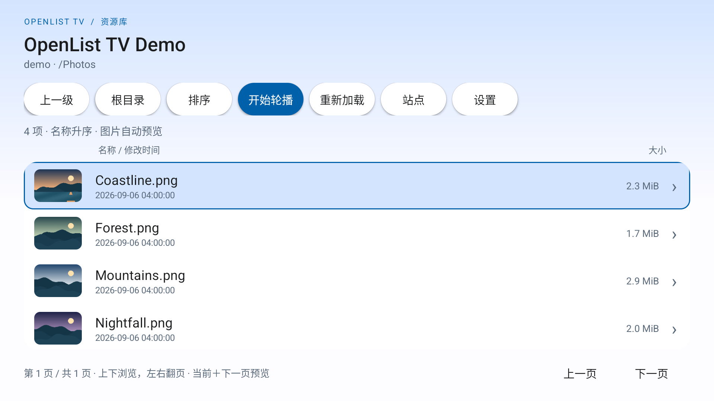
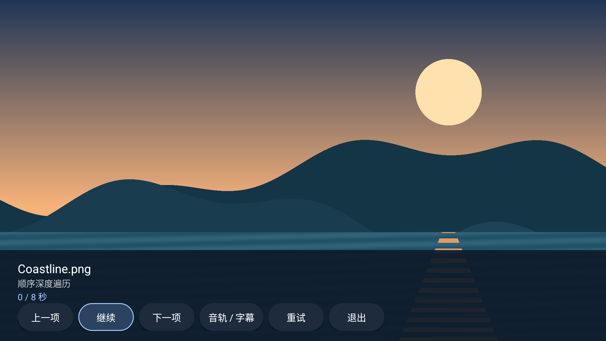
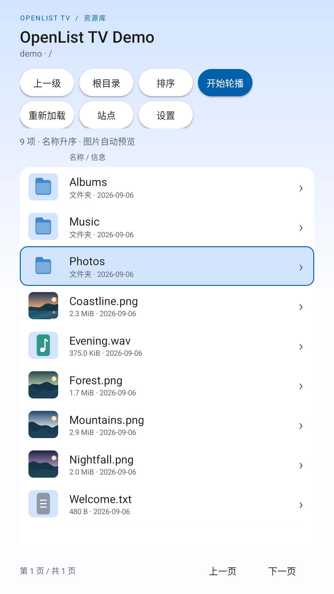
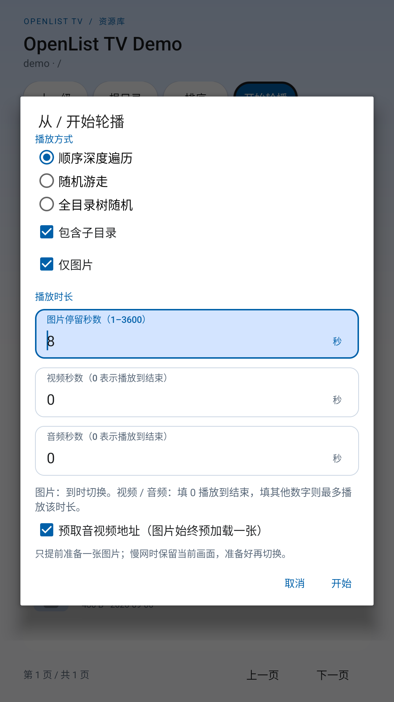

# OpenList TV

轻量原生 Android 客户端，为电视、投影和遥控器设计。

[下载 1.0.0 APK](https://github.com/LoliWolf/OpenListTV/releases/tag/v1.0.0) · [使用说明](docs/USAGE.md) · [飞书知识库](https://my.feishu.cn/wiki/LojHwxGlOiAofDk2JLocRIYinnb)

## 功能

- 多站点账号密码登录、目录密码、只读浏览和资源排序。
- 图片、音乐、视频播放，支持 HLS 和基础字幕选择。
- 顺序遍历、随机游走、全目录树随机三种轮播；图片提前解码、直接切换。
- 遥控焦点、横竖屏布局、系统深浅色、当前页＋下一页图片缩略图。
- 有界缓存与内存预算，正常覆盖升级保留配置。

Android 6.0+；1.0.0 支持按设备能力播放 4K SDR，不做本地视频转码。更新请直接覆盖安装，不要先卸载。

## 截图

实际 Release 应用截图；演示资源由本地程序生成，不包含私人文件。

<p>
  
  
</p>
<p>
  
  
</p>

## 开发

JDK 17、Android SDK 36 / Build Tools 36.0.0：

```sh
./gradlew :core:test :data:testDebugUnitTest :app:assembleDebug
```

[开发与签名](docs/BUILDING.md) · [架构与接续上下文](AGENTS.md) · [项目及第三方声明](NOTICE.md)
